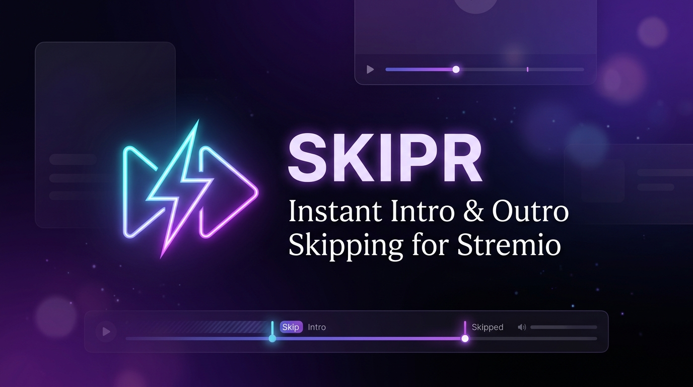
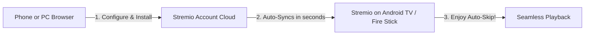
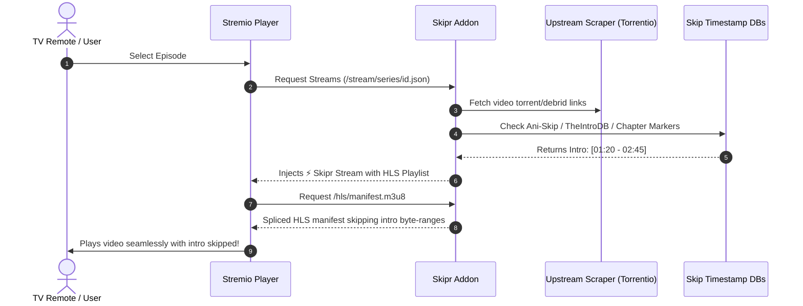

<div align="center">



# ⚡ Skipr

**The ultra-fast intro & outro auto-skipping addon for Stremio on TV & Desktop.**

[](https://opensource.org/licenses/MIT)
[](https://nodejs.org/)
[](https://stremio.github.io/stremio-addon-sdk/)
[](https://www.docker.com/)

[**Features**](#-features) • [**Quick Start for TV**](#-quick-start-for-tv) • [**How It Works**](#-how-it-works) • [**Self-Hosting**](#-self-hosting) • [**Configuration**](#-configuration)

</div>

---

## 💡 Why "Skipr"?

Typing long repository names or URLs using an on-screen TV remote is frustrating. **Skipr** is deliberately designed with a short, 5-letter name:

* **Quick to type on TV screens:** Easy to find with an on-screen keyboard remote.
* **Auto-Sync friendly:** Install once on your phone or PC with your Stremio account, and it syncs to your Android TV, Fire Stick, or Chromecast in seconds.
* **Zero Client Hacks Required:** Works on stock Stremio (Android TV, Google TV, Fire TV, Desktop, and Web) without requiring custom desktop-only mods.

---

## ✨ Features

- **⚡ Seamless Auto-Skipping:** Dynamically bypasses TV show intros, openings, and recaps without touching the remote.
- **🎯 Multi-Tier Timestamp Engine:**
  1. **Ani-Skip API:** Over 150,000+ anime opening (OP) and ending (ED) timestamps.
  2. **TheIntroDB & Offline Skips:** Hundreds of popular western series pre-indexed offline.
  3. **Embedded Chapter Probing:** Fallback to video chapter markers (`Intro`, `Opening`, `Credits`) via `ffprobe`.
- **📺 Dual Stream Routing:** Offers a dedicated `⚡ Skipr [Auto-Skip]` stream plus the `📺 Direct Stream` fallback so you always have a working stream.
- **🔓 Debrid Integration:** Works with Real-Debrid, TorBox, AllDebrid, and Premiumize.
- **🔄 Scraper Compatibility:** Sits seamlessly on top of **Torrentio**, **Comet**, **MediaFusion**, or **AIOStreams**.
- **🐳 1-Command Self-Hosting:** Run with Docker Compose or lightweight Node.js (no heavy external database needed).

---

## 📺 Quick Start for TV

You don't need to struggle typing long links on your TV remote. Stremio syncs all addons across devices tied to your Stremio account:



### Option A: The 10-Second Account Sync (Recommended)
1. Open the **Skipr Web Configurator** (`http://localhost:7005` or your hosted URL) on your phone or PC.
2. Select your Debrid provider and paste your API key.
3. Click **⚡ Install to Stremio**.
4. Turn on your TV and open **Stremio** — Skipr is now installed and active!

### Option B: Direct URL on TV
1. Open Stremio on your TV $\rightarrow$ Navigate to **Addons**.
2. Select **Add Addon** or search for:
   ```text
   http://<YOUR-IP>:7005/manifest.json
   ```

---

## 🛠️ How It Works

Standard Stremio addons only return stream links; they cannot send playback commands to the player. **Skipr** solves this with an intelligent HLS byte-range engine:



---

## 🚀 Self-Hosting

### Method 1: Docker Compose (Quickest)

```bash
# Clone the repository
git clone https://github.com/your-username/skipr.git
cd skipr

# Start with Docker Compose
docker-compose up -d

# View logs
docker-compose logs -f
```
Skipr is now running at `http://localhost:7005`!

### Method 2: Local Node.js

```bash
# Prerequisites: Node.js 18+ and ffmpeg
git clone https://github.com/your-username/skipr.git
cd skipr

# Install dependencies
npm install

# Run tests
npm test

# Start the server
npm start
```

---

## ⚙️ Environment Variables

Create a `.env` file to customize your setup:

| Variable | Default | Description |
| :--- | :--- | :--- |
| `PORT` | `7005` | The port Skipr listens on. |
| `PUBLIC_URL` | `http://127.0.0.1:7005` | Publicly reachable URL (for reverse proxies / domain). |
| `DEFAULT_SCRAPER_URL` | `https://torrentio.strem.fun` | Default upstream scraper to pull torrents from. |
| `DEFAULT_DEBRID_PROVIDER`| `realdebrid` | Default debrid service (`realdebrid`, `torbox`, etc.). |

---

## 📡 API Endpoints

- `GET /manifest.json` — Stremio Addon Manifest
- `GET /:config/manifest.json` — User-configured Addon Manifest
- `GET /stream/:type/:id.json` — Stream resolver with auto-skip routing
- `GET /hls/manifest.m3u8` — Dynamic HLS playlist generator
- `GET /configure` — Interactive web configurator UI
- `GET /health` — Addon health status

---

## 📄 License

This project is licensed under the [MIT License](LICENSE).
